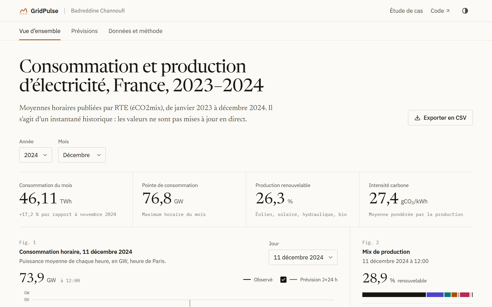
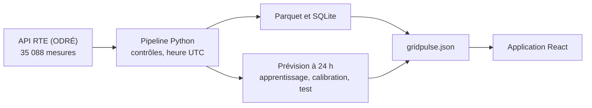

<p align="center">
  
</p>

<h1 align="center">GridPulse</h1>

<p align="center">
  La consommation et la production d'électricité en France, heure par heure, en 2023 et 2024,<br>
  et une prévision à 24 heures évaluée sur des semaines que le modèle n'a jamais vues.
</p>

<p align="center">
  <a href="https://badreddine05.github.io/gridpulse/"><strong>Ouvrir l'application</strong></a>
  &nbsp;·&nbsp;
  <a href="https://badreddine05.github.io/projets/gridpulse/">Lire l'étude de cas</a>
  &nbsp;·&nbsp;
  <a href="https://odre.opendatasoft.com/explore/dataset/eco2mix-national-cons-def/">Source RTE</a>
</p>

<picture>
  <source media="(prefers-color-scheme: dark)" srcset=".github/readme/gridpulse-dark.png">
  
</picture>

## Le projet

RTE publie toutes les demi-heures la consommation d'électricité de la France métropolitaine et la production de chaque filière. GridPulse récupère deux années de ces données publiques, les contrôle, les range dans un format qu'on peut interroger, puis les rend lisibles dans un observatoire interactif. Il compare aussi une prévision du lendemain à une référence très simple, en montrant ses erreurs.

L'application fonctionne sur un instantané historique : elle ne suit pas le réseau en direct.

## Ce que l'on peut faire

- Choisir une année et un mois, puis lire la consommation, la pointe, la part renouvelable et l'intensité carbone de la période.
- Parcourir une journée heure par heure, à l'heure de Paris, et la rejouer en animation ; le mix de production suit l'heure choisie.
- Cliquer dans le calendrier annuel pour retrouver une journée de pointe et sa courbe.
- Comparer la consommation observée, la prévision et la référence sur la période de test de novembre et décembre 2024.
- Exporter les données filtrées en CSV et consulter la provenance, les contrôles et les définitions.

Pas de compte, de clé d'API ni de serveur : tout se passe dans le navigateur.

## Ce que montrent les données

- Les pointes annuelles tombent en janvier, à 19 h : 83,3 GW le 23 janvier 2023 et 85,3 GW le 10 janvier 2024.
- Le nucléaire fournit 65 % de la production retenue en 2023, et 67 % en 2024.
- Sur les 1 389 heures de test, l'erreur absolue moyenne du modèle est de 2 710 MW, contre 4 961 MW pour la référence (la même heure, une semaine plus tôt) : 45,4 % de moins, sur un seul hiver.
- L'intervalle annoncé à 90 % ne contient que 47,37 % des observations de test. Calibré sur septembre et octobre, des mois plus calmes, il est trop étroit pour l'hiver ; l'application laisse ce défaut visible.

| Sur la période de test | Gradient boosting | Référence |
| --- | ---: | ---: |
| Erreur absolue moyenne (MAE) | 2 709,55 MW | 4 960,96 MW |
| Erreur quadratique moyenne (RMSE) | 3 539,45 MW | 5 742,04 MW |

## Comment ça marche



Le pipeline garde l'heure en UTC et l'affiche à l'heure de Paris, pour que les journées de 23 et 25 heures ne faussent pas les agrégats. Le modèle, un gradient boosting de scikit-learn, n'utilise que ce qui est connu au moment de la prévision. Le découpage suit le calendrier : apprentissage de janvier 2023 à août 2024, calibration en septembre et octobre 2024, test du 4 novembre au 31 décembre 2024.

## Essayer en local

Avec Node.js 22.12 ou plus récent :

```sh
npm ci
npm run dev
```

L'instantané des données est inclus. Pour retélécharger la source, réentraîner le modèle, lancer les tests ou construire l'image Docker, voir [docs/DEVELOPMENT.md](docs/DEVELOPMENT.md).

## Limites

- L'intensité carbone est celle de la production, selon la méthode RTE. Ce n'est ni une empreinte de consommation ni une analyse de cycle de vie.
- Les échanges avec les pays voisins et le pompage sont exclus du mix présenté.
- Le modèle suppose chaque mesure disponible dès la fin de son heure ; les délais réels de publication ne sont pas simulés.
- Une seule période de test, de huit semaines, et pas de données météo.

## Sources et crédits

Données : RTE, éCO2mix national consolidé et définitif, via ODRÉ, sous [Licence Ouverte Etalab 2.0](https://www.etalab.gouv.fr/licence-ouverte-open-licence/). Code sous licence [MIT](LICENSE). Polices Newsreader, IBM Plex Sans et IBM Plex Mono (SIL OFL 1.1), dont les licences sont dans [`public/licenses/`](public/licenses/) ; autres composants dans [THIRD_PARTY.md](THIRD_PARTY.md).

Projet personnel de [Badreddine Channoufi](https://badreddine05.github.io/), réalisé avec l'aide d'outils d'IA. Les années 2023 et 2024 sont celles des données, pas de la réalisation du projet.

<details>
<summary>English summary</summary>

GridPulse is a browser observatory of French electricity demand and generation in 2023 and 2024, built on RTE open data. A Python pipeline checks the data, stores it in Parquet and SQLite and trains a 24-hour forecast, evaluated chronologically on eight weeks it never saw. On that test the model cuts the mean absolute error of a seasonal baseline by 45.4 %, while its 90 % interval only covers 47 % of observations, a weakness the app shows openly.

</details>
