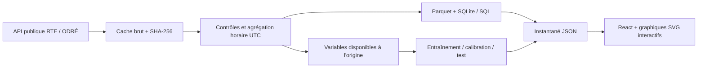

# GridPulse

**L'électricité française, en perspective.** Un observatoire interactif qui relie collecte de données, qualité, séries temporelles et visualisation.

[Ouvrir la démo](https://badreddine05.github.io/gridpulse/) · [Portfolio](https://badreddine05.github.io/) · [Source RTE](https://odre.opendatasoft.com/explore/dataset/eco2mix-national-cons-def/)

GridPulse explore **2023–2024**, à partir des données publiques de RTE. Il montre la consommation horaire, le mix électrique, les pointes annuelles et une prévision à 24 heures évaluée sur une période distincte de l'entraînement. La démo fonctionne sur un instantané embarqué : elle ne prétend pas suivre le réseau en direct.

## Ce que l'on peut faire

- Filtrer les indicateurs par année et par mois, puis explorer chaque journée à l'heure de Paris.
- Lire une journée avec une animation contrôlable ; le mix de production suit l'heure sélectionnée.
- Cliquer dans le calendrier annuel pour retrouver une pointe et sa courbe.
- Comparer consommation observée, prévision et référence hebdomadaire sur le test de novembre–décembre 2024.
- Afficher les résultats réels du modèle, y compris l'insuffisance de couverture de son intervalle.
- Exporter les données filtrées en CSV et consulter la provenance, les contrôles et les définitions.

L'interface est en français, adaptative, utilisable au clavier et respecte `prefers-reduced-motion`. Les polices sont embarquées. Aucun compte, secret, service payant ou appel API n'est nécessaire pour utiliser la démo.

## Démarrage rapide

Prérequis : **Node.js 22.12+** (ou 24) et npm. L'instantané public est versionné, donc Python n'est pas requis pour ouvrir le site.

```sh
npm ci
npm run dev
```

Ouvrir l'URL indiquée par Vite, normalement `http://127.0.0.1:5174`.

```sh
npm test
npm run build
npm run preview
```

`dist/` contient un site statique, compatible avec GitHub Pages et les hébergements sous-chemin grâce à `base: './'`.

### Docker

```sh
docker build -t gridpulse .
docker run --rm -p 8080:80 gridpulse
```

Le conteneur sert l'application compilée avec Nginx. Le pipeline Python reste une étape de préparation distincte.

## Reproduire les données et le modèle

Prérequis : Python **3.13**. Le téléchargement contient environ 35 000 observations ; le fichier brut et les sorties Parquet/SQLite restent hors Git.

```sh
python -m venv .venv
# Linux/macOS
. .venv/bin/activate
# Windows PowerShell : .venv\Scripts\Activate.ps1
python -m pip install -r requirements.txt
python pipeline/build_dataset.py
python -m pytest tests/test_pipeline.py -q
```

Le pipeline réutilise le cache `data/raw/rte-2023-2024.json`. Utiliser `--refresh` pour retélécharger la source. Une nouvelle version de la source peut modifier le checksum et les résultats : le manifeste permet de l'identifier.

Sorties :

- `data/processed/electricity_hourly.parquet` : table horaire typée ;
- `data/processed/gridpulse.sqlite` : table et vues SQL journalières, mensuelles et d'erreurs ;
- `data/processed/electricity_hourly.csv` : export complet ;
- `data/manifest.json` : provenance, empreinte SHA-256, contrôles et métriques ;
- `public/data/gridpulse.json` : données compactes servies par le site.

## Architecture



Le calcul analytique reste en Python et SQL. Le navigateur ne réentraîne pas de modèle : il filtre les mesures, recalcule les agrégats et présente les résultats pré-calculés. Cette séparation rend la démo rapide, vérifiable et hébergeable sans backend.

## Résultats réellement mesurés

Sur **1 389 heures valides de test**, du 4 novembre au 31 décembre 2024 (instants exacts dans le manifeste) :

| Indicateur | Gradient boosting | Référence, même heure une semaine avant |
|---|---:|---:|
| MAE | 2 709,55 MW | 4 960,96 MW |
| RMSE | 3 539,45 MW | 5 742,04 MW |

Le modèle réduit la MAE d'environ **45,4 % sur ce test**. Ce résultat ne constitue pas une garantie pour d'autres années.

L'intervalle calibré à un niveau nominal de 90 % ne couvre que **47,37 %** des observations de test. Ce défaut reste visible dans l'application. La calibration sur septembre–octobre ne représente pas correctement les erreurs hivernales ; les dépendances temporelles limitent également les garanties d'une calibration par quantile. Le projet montre cette limite, sans élargir l'intervalle après observation du test pour embellir le résultat.

## Qualité et limites des données

- **35 088 lignes source**, **35 084 instants distincts**, **17 544 heures** dans l'axe temporel.
- Quatre doublons de changement d'heure au printemps sont supprimés **uniquement lorsque toutes les mesures sont identiques**. Des valeurs contradictoires font échouer le traitement.
- Deux heures manquantes à l'automne sont conservées comme valeurs absentes. Aucune interpolation de la cible n'est effectuée. Les variables retardées propagent ces exclusions dans la calibration et le test.
- Une moyenne horaire n'est produite que si ses deux mesures demi-horaires sont présentes, pour chaque variable.
- L'intensité carbone est celle de la **production** selon la méthode RTE, pas une empreinte de consommation ni une analyse de cycle de vie.
- Les échanges internationaux et le pompage sont exclus du mix présenté. Les parts décrivent la production des huit filières retenues.
- Le modèle suppose les mesures disponibles dès la fin de leur heure ; les délais réels de publication ne sont pas simulés.

Voir [les conventions de données](docs/DATA.md) et [la fiche du modèle](docs/MODEL.md).

## Structure

```text
pipeline/build_dataset.py  Collecte, validation, stockage et prévision
sql/analytics.sql         Vues analytiques documentées
src/data.mjs              Calculs et transformations de l'interface
src/main.jsx              Exploration, prévisions et provenance
src/style.css             Design adaptatif et animations
tests/                    Invariants métier et tests anti-fuite
public/data/              Instantané public reproductible
data/manifest.json        Traçabilité du fichier source
docs/                     Méthode, modèle et guide d'entretien
```

## Vérification

Les tests Python vérifient l'intégration MW → MWh, les doublons contradictoires, les valeurs absentes, la séparation temporelle et l'absence d'observations futures dans les variables. Les tests JavaScript vérifient les agrégats, la pondération carbone, l'export CSV, le calendrier et la cohérence de l'instantané. GitHub Actions exécute ces tests et le build à chaque push et pull request.

## Présenter le projet

[Le guide d'entretien](docs/INTERVIEW.md) propose un parcours de démonstration, les décisions techniques à expliquer et les limites à connaître. Une formulation CV possible, à utiliser après appropriation du code :

> Observatoire de l'électricité française : pipeline Python/SQL sur les données RTE, contrôles de qualité, prévision à 24 h évaluée chronologiquement et application React avec visualisations interactives.

## Auteur et licences

Projet personnel de **Badreddine Channoufi**, développé avec assistance IA. Le code est sous licence MIT ; les données RTE sont sous Licence Ouverte Etalab 2.0. Voir [THIRD_PARTY.md](THIRD_PARTY.md). Les dates 2023–2024 désignent les données, pas la date de réalisation du projet.

Les polices DM Sans et Space Grotesk proviennent des paquets Fontsource et sont servies localement. Leurs notices SIL Open Font License 1.1 sont copiées sans modification dans [DM-Sans-OFL.txt](public/licenses/DM-Sans-OFL.txt) et [Space-Grotesk-OFL.txt](public/licenses/Space-Grotesk-OFL.txt), puis incluses dans le site compilé.
